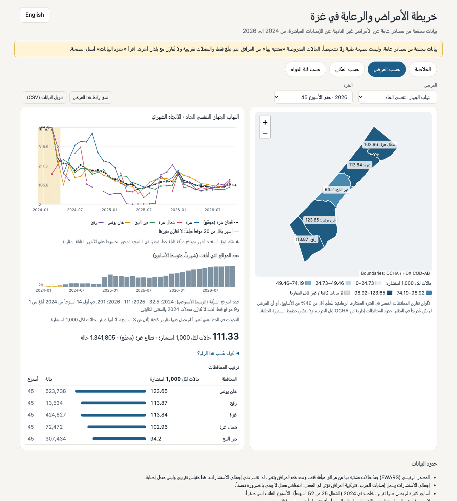
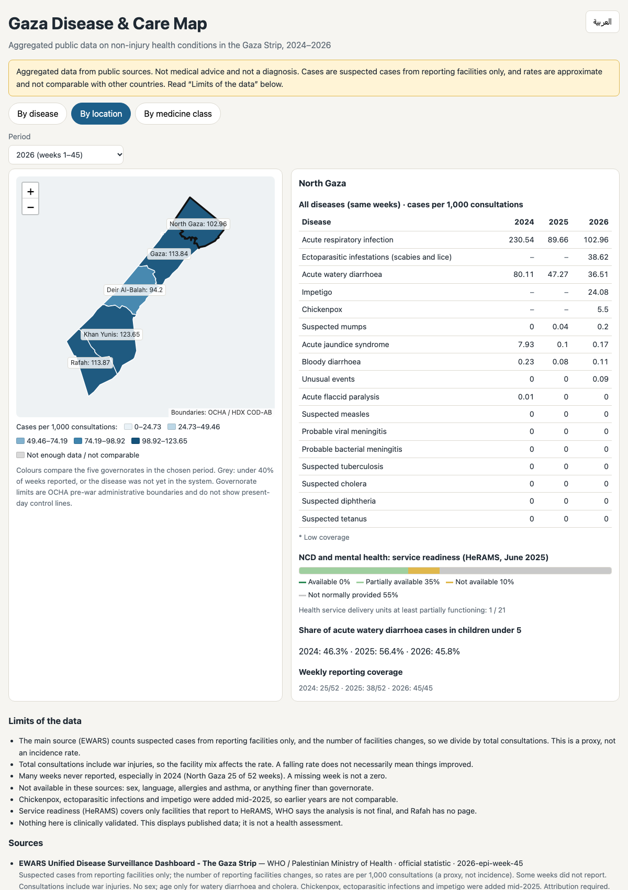

# Gaza Disease & Care Map · خريطة الأمراض والرعاية في غزة

A static, bilingual (Arabic RTL / English) map of non-injury health conditions in the Gaza Strip, 2024–2026,
built from public WHO / Ministry of Health surveillance data (EWARS), WHO HeRAMS service readiness, and
OCHA boundaries. **A display of published data: not medical advice, not a diagnosis, not clinically validated.**

This is a side project inside the MedRelay repository; it is not part of the MedRelay roadmap.

| By disease (Arabic) | By location (English) |
|---|---|
|  |  |

## What it shows

- Cases per 1,000 consultations by governorate, for 17 notifiable conditions, with a monthly trend.
- Per governorate: all diseases side by side, service readiness for chronic disease and mental health (HeRAMS),
  under-5 share of acute watery diarrhoea, weekly reporting coverage.
- Shareable views: `?lang=en&tab=location&loc=rafah&disease=awd&year=2025`.
- **Key facts** (landing tab): six facts computed from `data.json` at page load (nothing typed by hand), each
  with its caveat and a link to the view it comes from, plus a hand-checked further-reading list
  (`reference/further_reading.csv`).
- Every view: the address bar always equals the current view (copy-link button), a CSV download of the
  numbers behind it, and a "how was this number calculated?" box showing cases ÷ consultations × 1,000.
- The trend axis is scaled on comparable months; months with fewer than 20 reporting sites are shaded and
  clipped (▲) so early 2024 cannot flatten the rest of the chart.

## Honest limits (also shown on the site)

Suspected cases from reporting facilities only; rates are a proxy, not incidence; consultations include war
injuries; many weeks never reported (missing is not zero); some diseases were added mid-2025; no sex, language,
allergy/asthma or sub-governorate data in these sources; HeRAMS is not final and has no Rafah page.
The "by medicine class" tab has 22 rows from `reference/medicine_classes.csv`, each linked to a WHO or CDC treatment page (general guidance, not Gaza-specific). It never shows drug names or doses; diseases with no source (mumps, bloody diarrhoea, AFP) have no row. It also shows dated stock-out figures (`supply_signals.csv`, sources conflict, never merged) and the HeRAMS NCD service table.

## Pipeline

```
data/raw  --clean_ewars-->  data/clean  --build_db-->  SQLite  --export_site-->  site/data/data.json
OCHA boundaries --build_geo--> site/data/governorates.geojson
```

Rebuild commands are in [site/README.md](site/README.md). Tests: `python3 -m pytest gaza_map/tests -q`
(70 tests, including a source audit against the dashboard totals and the WHO PDF).
Raw and cleaned data are not committed (`data/` is git-ignored); the aggregated site data files are.

## Credits and attribution

- EWARS: WHO / Palestinian Ministry of Health. Ask WHO oPt / the EWARS focal point before publishing.
- HeRAMS: WHO occupied Palestinian territory, data to 30 June 2025.
- Boundaries: OCHA / HDX COD-AB (pre-war administrative limits).
- Leaflet (BSD-2) loaded from cdnjs.
